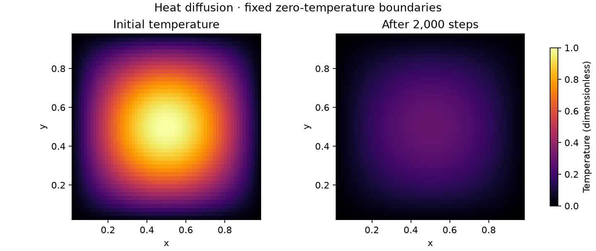

# Heat MPI

**A reproducible study of heat diffusion with C and MPI.**

A serial reference and a distributed row-decomposed solver evolve the same
2-D heat equation. Analytical checks, independent small-grid expectations and
complete-field comparisons make numerical correctness visible before performance.

An educational HPC project with passing Linux validation for Open MPI and MPICH.
See [validation](docs/validation.md) for evidence and scope.
Multi-node performance remains unverified.

## Quick start

Requires a C11 compiler, an MPI implementation, Make and Python 3.10+.
For the author’s mixed-architecture Mac setup, see the
[local compiler workaround](docs/local-environment.md).
On Ubuntu: `sudo apt-get install build-essential openmpi-bin libopenmpi-dev python3 file`.

```sh
make CC=mpicc
make CC=mpicc test
./build/heat_serial 63 47 100 sine serial.csv
mpiexec -n 4 ./build/heat_mpi 63 47 100 sine parallel.csv
```

CSV paths must be new; existing files are never overwritten. Omit the filename
(or use `-`) to avoid gathering/writing the field. CSV contains interior grid
indices and values, ordered by row. Boundary values are exactly zero.

Arguments: `NX NY STEPS sine|impulse [new-field.csv|-]`. Dimensions must be positive,
with at most 10 million interior cells and no more MPI ranks than interior rows.
Steps may be zero. Each run prints one JSON timing/error record on rank zero.
`continuum_linf` is a discretization error measurement for sine, or `null` for
impulse; it is not a general pass/fail correctness certificate.



Recreate this illustration with `python3 scripts/plot_field.py NEW.png` (optional
Matplotlib dependency). Both panels use the same temperature scale.

## How it works

Each rank owns contiguous rows and two halo rows. Neighbor exchanges supply the
stencil's north/south values; local left/right boundaries remain zero. Remainder
rows are distributed to the first ranks, so divisibility is not required.

```text
rank 0: physical zero boundary | owned rows | lower halo
rank 1: upper halo             | owned rows | lower halo
rank 2: upper halo             | owned rows | physical zero boundary
```

The serial and MPI binaries share the same arithmetic and build flags. Tests use
separate mathematical/Python expectations to avoid relying solely on that shared
implementation. Read [numerics and tradeoffs](docs/numerics.md).

## Reproduce measurements

```sh
python3 scripts/benchmark.py results/local-example
```

This first runs the integration suite, then performs a separate warm-up and five
repeats for serial and 1/2/4 MPI ranks at fixed 256×256 cells and 200 steps. The new
results directory contains commands, raw samples, compiler/MPI metadata and source
and executable hashes. Timing includes halo exchange and stencil updates; output,
initialization and validation are outside the timed region. Min/median/max expose
variation. Progress is saved after each repetition; interrupted results remain
labelled `incomplete`. These are local measurements, not evidence of multi-node scaling.

For a fair comparison use the same compiler/architecture/flags for both binaries
(`CC=mpicc`). Rebuild after changing flags: `make clean && make CC=mpicc`.
The current Makefile does not fingerprint command-line build-variable changes.

## Linux validation and contribution

The Ubuntu workflow targets both Open MPI and MPICH. Each job builds from scratch,
runs the numerical suite and serial sanitizers, exercises benchmark reproduction,
and saves logs tied to the tested commit. See [GitHub readiness](docs/github-readiness.md)
for the current execution status and [contribution guidance](CONTRIBUTING.md).

## Scope and ownership

This project is a new implementation from the mathematical specification in
`docs/numerics.md`. It contains no copied assessment source, submissions, lecture
slides or recovered cluster files. See [provenance](docs/provenance.md).

Licensed under the [MIT License](LICENSE). Dependencies retain their own licenses.

Near-term extensions are driven by measurements: communication/computation
breakdown, then overlap or 2-D decomposition if justified. GPU support, weak-scaling
claims, restart and general material models are outside the current release scope.
